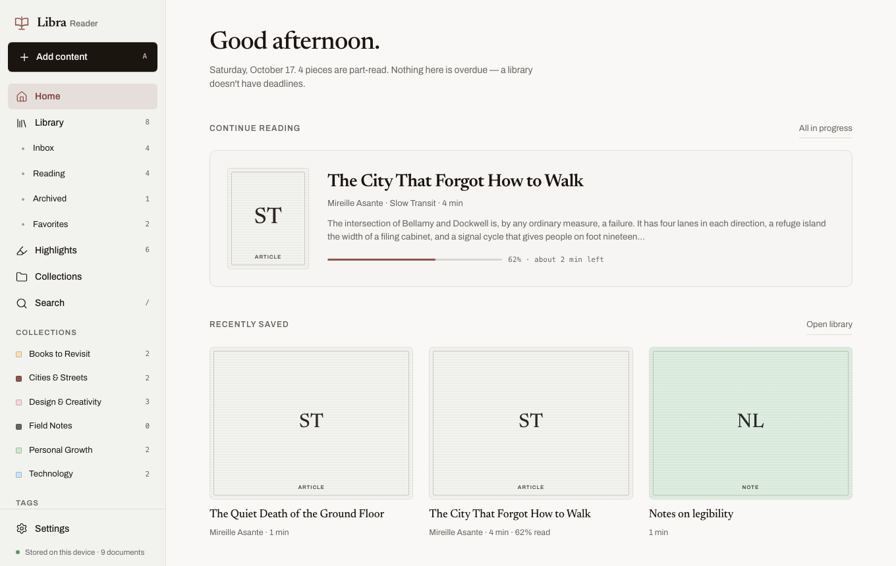
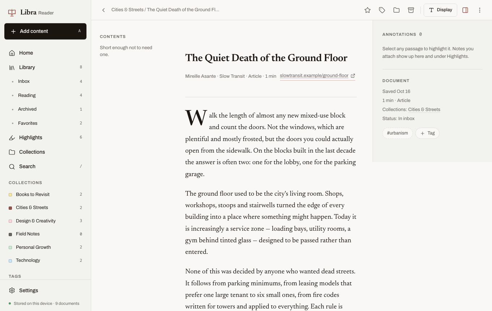
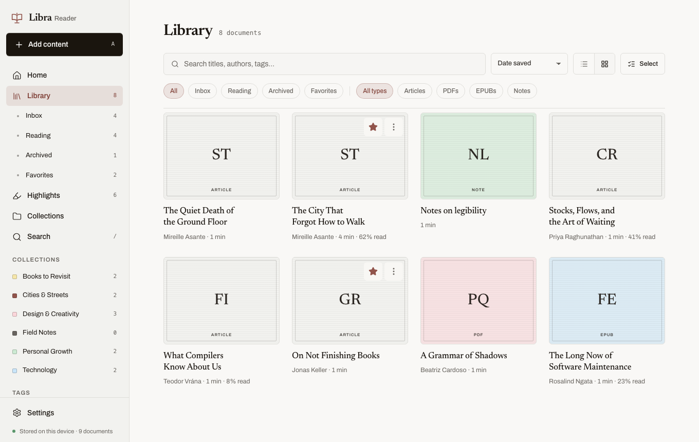
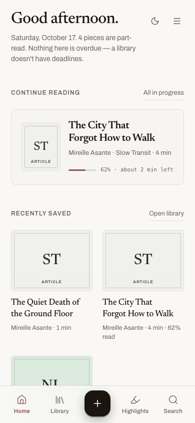

# Libra Reader

A local-first place to save, read, highlight, and organize articles, PDFs, EPUBs, and personal notes. Everything lives on your machine: a SQLite database and a folder of uploaded files.

**Core flow:** save content → read it → highlight and annotate it → organize it → revisit highlights.

## Screenshots









## Quick start

Requires Node.js 22.12 or newer.

```bash
npm install          # also generates the Prisma client and copies PDF.js assets
npm run setup        # creates the database and adds the sample library
npm run dev          # http://localhost:3000
```

`npm run setup` only adds sample content to an **empty** database. If anything already exists it does nothing, and it refuses to run with `NODE_ENV=production` (override with `LIBRA_ALLOW_SEED=1`). To start completely empty, run `npm run db:deploy` instead.

## Docker

```bash
docker compose up --build
```

Then open http://localhost:3000. The database and uploads live in a Docker volume named `libra-data`, separate from the `data/` folder used by `npm run dev`. The first start applies migrations and, because the database is empty, adds the sample library. Set `LIBRA_SEED=0` to start empty:

```bash
LIBRA_SEED=0 docker compose up --build
```

The port is published on `127.0.0.1` only. Libra has no login, so don't publish it on a wider address as it is. The container clock is UTC unless you set `TZ` (for example `TZ=Asia/Hong_Kong docker compose up`); the greeting and dates follow that clock. To keep the files in the project folder instead of a volume, stop the dev server and switch the volume in `docker-compose.yml` to `./data:/data`. SQLite should have only one writer, so don't run Docker and `npm run dev` against the same database.

## What it does

- **Library:** list and grid views, search, status/type/tag/collection filters, sorting, favorites (separate from reading status), archive with Undo, multi-select with bulk tag / collection / favorite / archive / delete, and delete confirmation.
- **Add content:** one dialog with three tabs.
  - *Paste a URL.* The server fetches the page, extracts the article with Readability, sanitizes it, estimates reading time, and shows a preview before saving. If extraction fails you can retry or save the link only; nothing is ever invented.
  - *Upload a PDF or EPUB* (up to 50 MB). Files are checked by their bytes, stored outside `/public`, and served through `/api/files/[id]`.
  - *Write a note.* An editable title and body.
- **Reader:** a centred column, table of contents, progress bar, reading position restored by text offset (it survives font and width changes), and display controls for typeface, size, line spacing, column width, and theme. Favorite, archive, tag, and collection actions are in the toolbar, and a collapsible annotations panel sits alongside in every reader. Press `]` to open or hide it.
- **Highlights:** select text to get a floating toolbar (four named colours, add note, copy). Works in articles, notes, PDF pages, and EPUB chapters. Highlights span paragraphs safely, survive reloads, and can be recoloured, annotated, or deleted (with Undo). The Highlights page offers search, filters, links back to each passage, and a one-at-a-time review mode.
- **Assist:** summarize a document, outline it, explain a highlight, or ask a question about the passage. Connect an OpenAI-compatible host in Settings — OpenAI, or a local server such as Ollama at `http://127.0.0.1:11434/v1`. The key stays in the database, is never sent to the browser, and is left out of JSON export. Answers are labeled as generated and saved with the document. Long documents are shortened, and the model is told to stay with the text it was given.
- **PDF and EPUB:** PDF.js renders PDFs with zoom and saves the page you were on. epub.js renders EPUBs with chapter navigation and saves your location. Both can flip one page at a time or scroll to the next. Select text in either one to highlight it, and both carry the same annotations list, document facts, and Assist panel as the article reader. In an EPUB the highlight is drawn over the chapter and returns to the same passage when the text reflows or you turn back to it. Embedded scripts, forms, and links inside files stay inactive.
- **Search:** across titles, authors, extracted article and book text, highlights, and notes, with grouped results and marked snippets.
- **Settings:** theme (light, dark, or follow the system), reading defaults with a live preview, a keyboard shortcut reference (press `?` anywhere), the Assist model connection, a JSON export of everything, and installing Libra as an app.
- **Installed app:** add Libra to the dock or home screen and it opens in its own window. Chrome and Edge show an Install button in Settings when the browser allows it. Pages are loaded from the local server; if that server is stopped, the window explains that instead of showing a broken page.

## Scripts

| Command | What it does |
| --- | --- |
| `npm run dev` | Development server |
| `npm run build` / `npm start` | Production build and server |
| `npm run lint` | ESLint (Next.js core-web-vitals + TypeScript rules) |
| `npm run typecheck` | Generates route types, then `tsc --noEmit` (strict) |
| `npm test` | Vitest unit and integration tests |
| `npm run test:e2e` | Playwright end-to-end tests (see below) |
| `npm run db:migrate` | Create a new migration during development |
| `npm run db:deploy` | Apply migrations |
| `npm run db:seed` | Add sample data to an empty database |
| `npm run db:studio` | Browse the database in Prisma Studio |

## Configuration

Copy `.env.example` to `.env` if you want to change the defaults:

| Variable | Default | Purpose |
| --- | --- | --- |
| `DATABASE_URL` | `file:./data/libra.db` | SQLite database file |
| `LIBRA_STORAGE_DIR` | `./data/uploads` | Uploaded PDFs and EPUBs |

Relative paths resolve from the project root. `data/` is gitignored.

## Data and privacy

- All documents, highlights, notes, collections, tags, preferences, and Assist answers live in the SQLite file. Uploaded originals live in the storage folder under random names. The model API key lives in that database too, and is not included in export.
- **Settings → Export JSON** downloads everything except the original PDF and EPUB bytes, which stay in the storage folder, and except the model API key.
- Libra contacts the internet when you ask it to fetch a URL, and when you run Assist, which sends that passage to the model host you configured. Images inside saved articles still load from their original sites when you read them. If Libra is running in Docker and the model is on your computer, point Assist at `http://host.docker.internal:11434/v1` rather than `127.0.0.1`, which inside the container is the container itself.

## Security model

Libra is a single-user app meant to run on `localhost`. It has no accounts or authentication, so don't expose it to a network as is. Within that scope:

- **URL fetching (SSRF):** only `http`/`https` on standard ports, with no embedded credentials. Every resolved address is checked, and private, loopback, link-local (including cloud metadata), CGNAT, reserved, and IPv4-mapped ranges are rejected, as are `localhost`, `.local`, and single-label hosts. Validation runs in the socket's DNS lookup, so the address checked is the address connected to. Every redirect is re-validated (at most 5). The whole fetch has a 15-second timeout, and decompressed size is capped at 5 MB. See `lib/ssrf.ts` and `lib/safe-fetch.ts`.
- **Assist:** the model endpoint is checked separately, and article fetching is unchanged. Public hosts stay on standard ports and must resolve only to public addresses. Loopback and private addresses are allowed on any port so a local model can answer. Link-local addresses, including cloud metadata, stay blocked, and a name that resolves to both public and private addresses is rejected. Redirects are not followed. The API key is stored in SQLite and is not included in client props or the JSON export. See `lib/assist-endpoint.ts`.
- **Untrusted HTML:** `sanitize-html` runs with a strict allowlist. Scripts, styles, iframes, forms, SVG, event handlers, and `javascript:`/`data:` URLs are removed. Links get `noopener noreferrer`, images load lazily with no referrer, and incoming ids are replaced so saved pages can't clobber DOM globals. See `lib/sanitize.ts`.
- **Uploads:** the file type comes from magic bytes and must agree with the extension. EPUB entries are size-checked before inflating, and DRM-protected EPUBs are refused. Files are served with `nosniff` and a `default-src 'none'; sandbox` CSP.
- **Requests:** Server Actions validate every input with Zod. Route handlers that change data reject cross-site requests. The app sends a CSP and the usual hardening headers (`next.config.ts`).

## Architecture

```
app/                    Routes (App Router). Server components by default.
  (app)/                Shell layout + Home, Library, Reader, Highlights, Collections, Search, Settings
  api/                  uploads, files/[id], export, documents/[id]/position
components/             Client components only where there is interaction
  ui/                   shadcn/ui primitives restyled to the Libra tokens
  reader/               Article, PDF, and EPUB readers, selection toolbar, annotations
lib/
  actions/              Server Actions (documents, import, highlights, collections, preferences, assist)
  anchoring/            Highlight anchoring: quote + prefix/suffix + offsets, and DOM wrapping
  queries.ts            Data access for server components
  ssrf.ts, safe-fetch.ts, assist-endpoint.ts, assist.ts, extract.ts, sanitize.ts, files.ts, storage.ts, validation.ts
prisma/                 Schema, migrations, seed and its sample content
tests/                  Vitest
e2e/                    Playwright
desgin/                 The approved design comps and brand spec this UI follows
```

Highlights are anchored like W3C Web Annotation selectors. Each one stores the quote, 32 characters of context on each side, and character offsets. On load, Libra tries the offsets, then searches for the quote and ranks matches by context, then retries with whitespace normalized. If a passage can no longer be found, the highlight is listed as missing rather than attached to the wrong text. A PDF highlight carries its page number and offsets inside that page's text layer, and is re-anchored by quote when the page is rendered again at another zoom. An EPUB highlight carries an epub.js book location (a CFI range) instead, and is drawn as an SVG mark over the chapter, so it survives reflow and page turns.

## Testing

```bash
npm test                         # unit + integration (a throwaway SQLite database in .tmp/test)
npx playwright install chromium  # once
npm run test:e2e                 # builds, seeds a throwaway database in .tmp/e2e, serves on :3200
```

Unit tests cover validation, sanitization, SSRF checks, the redirect and size limits of the fetcher, highlight anchoring (string and DOM), the rules for which document types may hold a page or a book location, article extraction, upload detection, and collection deletion. End-to-end tests cover saving a note, creating a collection, highlighting with a note, reload persistence, the annotation list in the PDF and EPUB readers, archive and restore, search, the mobile reader, uploads, bulk actions, export, shortcuts, and a check that core pages log no console errors. Set `PW_CHANNEL=chrome` to run them in your installed Chrome. `E2E_REBUILD=1` forces a fresh build.

## Known limitations

- There is no OCR. Scanned PDF pages have no selectable text, and a DRM-protected EPUB has no text to select either. The reader says so.
- Search uses substring matching (case-insensitive for ASCII), not ranked full-text search.
- Reading preferences are global, not per document.
- The library view shows up to 1,000 documents at a time; there is no pagination yet.
- There is no import from other services (Pocket, Instapaper) and no sync between devices.
- The installed app does not keep a copy of the library. Reading needs the server on this computer.

## Stack

Next.js 16 (App Router) · React 19 · TypeScript 6 (strict) · Tailwind CSS 4 · shadcn/ui on Radix · Lucide · Prisma 7 with SQLite (better-sqlite3 adapter) · Zod 4 · Readability + jsdom · sanitize-html · PDF.js · epub.js · Vitest · Playwright.

TypeScript stays on 6.0 and ESLint on 9 because typescript-eslint and the plugins in `eslint-config-next` don't support TypeScript 7 or ESLint 10 yet. Prisma stays on 7.10, the latest stable release.
